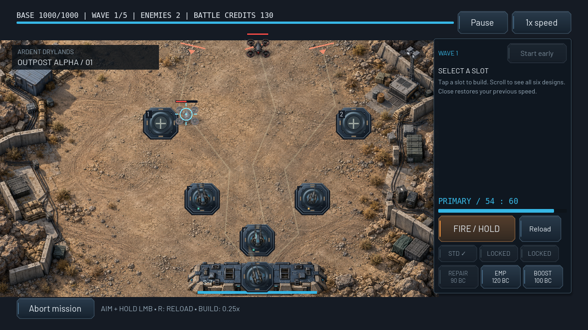

# DRONE KILLER: FRONTLINE

A native Godot 4 game foundation for an offline Android-first defense campaign. Command Sentinel-7 against the Varkon Empire in Asteria. All 25 campaign territories are playable. Five chapter bosses, shield/EMP/sniper/carrier/stealth behaviors, environmental pressure and a persistent finale extend the existing manual cannon, six automatic defenses, ammunition, research and tactical abilities. See [campaign design and validation](docs/CAMPAIGN.md). Graphics G1 adds original generated key art, rendered drone/weapon sprites, Outpost Alpha terrain, animated explosions, a reusable military UI theme and locally bundled fonts. See [VISUAL_STYLE.md](VISUAL_STYLE.md), the [asset manifest](assets/manifest.json) and [native visual validation](docs/VISUAL_VALIDATION.md).

## Download

Repository: https://github.com/vladovidiu1/game-drone-killer

Use **Code → Download ZIP** on GitHub, or clone the `main` branch. Extract the ZIP and import its `project.godot` file in Godot. This is the complete source project; an Android APK is not included.

## Open and play

Use **Godot 4.6.3 stable**, standard GDScript edition. No plugins, external assets, package installation, accounts, or credentials are required.

1. Import `project.godot` in the Godot project manager.
2. Press **F6** only when testing an individual scene; use **F5** to launch the complete game.
3. Choose **New Campaign → 01 Outpost Alpha → Start Mission**.
4. Click or touch a glowing build slot, then choose Machine Gun, Cannon, or Missile Launcher in the sidebar. Turrets fire automatically. Select an existing turret to upgrade it.
5. Aim the primary cannon with the mouse and hold left click over the battlefield to fire; press **R** to reload. On Android, drag a finger in the left aiming area and hold the large **FIRE** button on the right with another finger.
6. Survive all mission waves while keeping the base above 0 HP. Outpost Alpha starts with 500 battle credits and 1000 base HP. Drone bounties fund more defenses. Use **Start wave early** to skip the preparation countdown; **1x / 2x speed** controls combat speed.

Command-line desktop startup from the repository root:

```sh
godot --path . --editor
godot --path .
```

After victory, use **Next: [mission]** or the campaign map to read the next briefing and deploy. After defeat, use **Retry [returned territory]** to defend the retreated frontline. All 25 missions use the same reusable battle scene.

New Campaign requires confirmation when replacing an existing save. Continue is disabled until a campaign exists. Escape / Android Back pauses a battle and returns to the main menu from other screens. Losing focus pauses the battle; press Resume after returning. Aborting counts as defeat.

## Visual foundation G1

These are actual native Godot captures of the running project:




The [visual validation gallery](docs/VISUAL_VALIDATION.md) also includes a live explosion, tactical construction and a wider landscape layout. [VISUAL_STYLE.md](VISUAL_STYLE.md) describes the art direction, budget, exact replacement specifications and artwork still needed. The [asset manifest](assets/manifest.json) records dimensions, frames, provenance, licenses and integration status. No generation service or font download is needed to run the game.

## Implemented scope

- Compatibility renderer; 1280×720 reference canvas, expanding aspect layout, landscape orientation, mobile safe-area margins, scrollable campaign chapter rows.
- Main menu, campaign map, mission briefing, gameplay HUD, pause/resume, results, Arsenal, and persistent volume/mute settings.
- 25 playable territories grouped into the five requested chapters. Controlled, contested, enemy/locked, and secured checkpoint states use labels and colors.
- Mission 1, **Outpost Alpha**: 51 enemies across five waves, entering from the top along three configurable paths toward the base at the bottom. Five fixed turret slots, automated target acquisition, rotating barrels, real projectiles, missile splash damage, health bars, muzzle flashes, hit flashes, explosions, selected range/target indicators and base damage feedback.
- Machine Gun: 100 credits, 10 damage, 4 shots/s, 240 range. Cannon: 200 credits, 55 damage, 0.8 shots/s, 260 range. Missile Launcher: 350 credits, 80 damage, 0.5 shots/s, 300 range, 75 splash radius.
- Scout: 40 HP, 120 units/s, 25 base damage, 10-credit bounty. Assault: 100 HP, 75 units/s, 50 base damage, 20-credit bounty. Heavy: 300 HP, 40 units/s, 100 base damage, 60-credit bounty.
- Turrets target the enemy with the shortest remaining path to the base; spawn order breaks ties. Projectiles use swept target-circle collision and consume themselves before impact resolution. Missiles apply one area hit per enemy, including the direct target.
- Each turret can reach level 3. Per level: damage ×1.5, range +16; upgrade cost is `ceil(base cost × 0.65 × current level)`. Permanent Arsenal damage bonuses still apply. All tuning lives in JSON.
- HUD displays base HP, wave, remaining enemies, battle credits, pause/resume, speed and build countdown. Native touch buttons own separate finger IDs, supporting slot selection and another finger on a build control without mouse emulation.
- Mission victory rewards are 120 / 180 / 250 permanent credits for missions 1 / 2 / 3. Defeat grants **zero** credits. Permanent damage upgrades have five levels. Replays award once per new deployment but cannot advance past that mission; replay defeats obey the same retreat rule.
- Frontline progression and chapter checkpoint floor rules are implemented independently of mission presentation.
- A dedicated manually controlled primary cannon, loaded at the start without using a placement slot. Its projectiles fly straight, with range-limited swept collision, recoil, muzzle flashes, trails, hit markers and reload feedback.
- Generated rendered artwork, authored vector UI/effects, licensed bundled fonts and synthesized shot/hit/reload/result sounds; no paid assets or external runtime services.

## Arsenal, research and two currencies

**Battle Credits** are the temporary `battle.credits` balance: mission starting budget plus drone bounties. Construction, temporary turret levels and tactical abilities spend only this balance; a new mission resets it. **War Credits** are the persistent `SaveManager.state.credits` balance, spent only on research/unlocks. Mission victories and once-only objectives award War Credits. Defeat does not remove them or research.

Open **Arsenal** from the main menu or campaign. Its four tabs are **PRIMARY CANNON**, **AUTOMATIC TURRETS**, **RESEARCH** and **SPECIAL ABILITIES**. Research cards show current level, next benefit, escalating War Credit cost, requirements and maximum status. A confirmation dialog reviews the actual purchase; cancellation spends nothing. Stale/double confirmations cannot buy a second level. Prices, five-level limits, coefficients, unlock requirements and objectives are configured in `data/progression.json`.

| Permanent upgrade | Per-level effect (5 levels each) |
| --- | --- |
| Cannon Damage | +5% primary damage |
| Fire Rate | +4% primary firing rate |
| Magazine Capacity | +10 rounds |
| Reload Speed | -6% base reload duration |
| Projectile Velocity | +5% projectile speed |
| Critical Hit Chance | +2 percentage points |
| Critical Damage | +10 percentage points on the critical bonus (default 1.5×) |
| Base Health | +100 maximum HP |
| Starting Battle Credits | +50 starting credits |
| Automatic Turret Damage / Range / Fire Rate | +5% / +3% / +4% |
| Repair Efficiency | +5% healed HP, rounded down |
| Repair / EMP / Overclock Mastery | -4% respective ability cooldown |

Bonuses apply to the existing base stats. Five primary levels produce 18.75 damage, 7.2 shots/s, 110 rounds, 1.4s reload, 1062.5 projectile speed, 10% critical chance and 2× critical damage, before legacy bonuses or ammunition. Existing purchased 15%-per-level Kinetic Amplifier bonuses remain as a separate legacy modifier; they are neither erased nor converted into the new 5% research. Research is snapshotted before a battle starts.

| Primary ammunition | Effect / tradeoff | Unlock |
| --- | --- | --- |
| Standard | Normal damage/rate, 1 round per shot | Available initially |
| Armor Piercing | 1.75× damage against Assault/Heavy armor, 25% slower fire | Highest mission 2, 180 War Credits |
| Explosive | 45-unit splash, 75% damage, 3 rounds per shot | Highest mission 3, 260 War Credits |

Use **STD / AP / EXP** in the battle HUD. Each has a distinct color for shots and crosshair; critical hits flash a red hit indicator. Changing types preserves ammunition and the firing cooldown, cannot refill the magazine, and is disabled while reloading. In-flight shots keep the profile they were fired with. The equipped type is saved. The Arsenal shows base researched statistics plus equipped-ammunition modifiers.

| New autonomous defense | Battle cost | Behavior | Research unlock |
| --- | --- | --- | --- |
| Laser Turret | 250 | 24 base DPS, accurate continuous beam, 270 range | Highest 2, 220 War Credits |
| EMP Tower | 230 | Area slow to 35% movement for 2s, 5s base cycle, 230 range | Highest 3, 250 War Credits |
| Heavy AA Cannon | 450 | 180 damage, 0.25 shots/s, 340 range | Highest 3, 300 War Credits |

Machine Gun, Cannon and Missile Launcher stay available from the start. All six acquire targets autonomously and support temporary battle levels and permanent defense research. Laser DPS scales with damage and rate research/Overclock; EMP pulses are nonstacking slows, and affected drones display a status ring.

| Tactical ability | Battle cost | Default cooldown | Effect |
| --- | --- | --- | --- |
| Emergency Repair | 90 | 30s | Restore 250 HP, improved by Repair Efficiency and capped at maximum HP |
| EMP Blast | 120 | 45s | Disable drones within 650 units for 2.5s |
| Overclock | 100 | 40s | 1.5× primary and automatic firing rate for 6s |

Abilities start available; mastery research improves their cooldowns. **REPAIR / EMP / BOOST** buttons display costs, remaining cooldown and active Overclock duration. Charges/cooldowns are consumed before applying an effect, so simultaneous/duplicate touch callbacks cannot activate twice. A full-health repair costs nothing and is unavailable. All durations, status recovery and effects use simulation time, freeze on pause, and reset with the mission.

Selecting a placement slot opens the single **tactical build/upgrade panel** and sets the effective simulation speed to **0.25× normal**, even if the previous choice was 2×. **Close** restores the prior 1×/2× choice. Selecting another slot reuses this panel; pausing/focus loss closes it and clears held input. The speed toggle is disabled while building. Manual aim and FIRE remain available at the same slowed rate; another finger may build, upgrade or scroll. Touch swipes on build buttons scroll the list and cancel the purchase gesture. World input never starts from HUD touches.

The Veteran Commander objective grants 150 War Credits once at five victories; securing checkpoint 5 grants 250 once. Objectives are applied inside the existing mission result transaction, persist across defeat, and cannot be claimed again by duplicate results or loading the save. They appear in the RESEARCH tab.

## Architecture and files

| Location | Responsibility |
| --- | --- |
| `project.godot` | Entry scene, renderer, resolution, mobile input, four autoloads |
| `scenes/main.tscn` | Root interface scene; composed native Control screens |
| `scenes/gameplay.tscn` | Reusable battle simulation scene |
| `scenes/drone.tscn` | Reusable enemy component |
| `scripts/core/save_manager.gd` | Schema v3 validation, v1/v2 migration, atomic replacement, backups and recovery |
| `scripts/core/campaign_manager.gd` | Catalog, access/territory state, persistent attempt tokens, reward transactions, advancement and checkpoints |
| `scripts/core/economy_manager.gd` | Transactional War Credit research/unlocks, legacy bonuses, effective stats and objective grants |
| `scripts/core/audio_manager.gd` | Audio settings and generated result cues |
| `scripts/game/battle.gd` | Fixed-step battle orchestration, battle credits, placement, impacts, outcome signals |
| `scripts/game/enemy_brain.gd` | Shared shield auras, EMP/sniper telegraphs, carrier launches, stealth cycles, boss phases/weakpoints and siege attacks |
| `scripts/visual/visual_assets.gd`, `unit_visual.gd` | Cached art bindings/atlas frames, composed body/shadow sprites and visual state shaders |
| `assets/`, `VISUAL_STYLE.md` | Bundled artwork/fonts/theme/shaders, provenance manifest and exact artist replacement specifications |
| `scripts/ui/main_menu.gd` | Native illustrated menu composition and navigation signals |
| `scripts/game/tactical_abilities.gd` | Battle-credit activations, cooldowns, disable pulses and shared Overclock timing |
| `data/progression.json` | Upgrade coefficients/costs, unlocks, ammunition, tactical abilities and once-only objectives |
| `scripts/ui/arsenal.gd` | Four research tabs, effective stats and guarded purchase confirmations |
| `scripts/game/wave_spawner.gd` | Reusable mixed-group waves, intermissions, early start, deterministic route cycling |
| `scripts/game/turret.gd`, `scenes/turret.tscn` | Target priority, range, rotation, fire cadence and upgrades |
| `scripts/game/projectile.gd`, `scenes/projectile.tscn` | Existing secondary homing/splash and additive straight manual rounds; swept collision and single-use impact lifecycle |
| `scenes/player_turret.tscn`, `scripts/game/player_turret.gd` | Dedicated primary cannon, magazine, reload, shared aim/fire intentions |
| `scripts/game/player_turret_view.gd` | Cannon artwork, recoil, muzzle flash, crosshair and reload ring |
| `scripts/game/player_input.gd` | Mouse/touch input abstraction, finger/source ownership, global release cleanup |
| `scripts/ui/player_weapon_hud.gd` | Ammo, reload progress, touch FIRE and Reload controls |
| `scripts/ui/battle_hud.gd` | Dedicated combat HUD, build shop, selection, upgrades, pause and speed |
| `scripts/ui/touch_button.gd` | Independent touch-pointer ownership with desktop mouse support |
| `scripts/game/battle_view.gd` | Battlefield presentation, separate from simulation |
| `scripts/game/drone.gd` | Waypoint movement, remaining path distance, health, breach/destruction signals and drone artwork |
| `scripts/ui/main.gd` | Screen navigation, selected-mission deployment and result transitions |
| `scripts/ui/mission_briefing.gd` | Scrollable location/story/intelligence/preparation/rewards and deployment gate |
| `scripts/ui/ui_kit.gd`, `backdrop.gd` | Reusable themed controls and decorative map-grid background |
| `data/definitions.json` | 25 mission definitions, wave groups, paths, slots, enemies, turrets and upgrade tuning |
| `tests/combat.gd`, `combat.tscn`, `hybrid.gd`, `hybrid.tscn`, `smoke.gd`, `smoke.tscn`, `campaign.gd`, `campaign.tscn`, `save_validation.gd`, `save_validation.tscn`, `research.gd`, `research.tscn`, `run_checks.sh` | Executable integration checks with isolated save data |
| `AGENTS.md` | Development conventions |

Godot-generated `.gd.uid` files are retained for stable resource identities. `.godot/` is an ignored generated import cache. UI screens are assembled from reusable native Controls in the root scene; they are not separate `.tscn` files. Battle, turret, projectile and drone scenes can be reused without menu dependencies. Signals report battle state, breaches, kills, economy changes, and campaign changes.

Save files are `user://campaign.json` and `user://settings.json`, outside the checkout. Godot's **Project → Open User Data Folder** reveals the platform-specific location. Starting a campaign resets campaign progression, credits, and upgrades; settings remain. A battle is not resumed after terminating the app; completed mission results and upgrades are saved.

## Connected campaign and save recovery

| Mission | Setting / location | Slots | Waves | Approaches | Victory reward |
| --- | --- | --- | --- | --- | --- |
| 1. Outpost Alpha | Dry military terrain / Ardent Drylands | 5 | 5 | Three top entries | 120 |
| 2. Red Hill Village | Rural farms and homes / Red Hill district | 6 | 6 | Two approach paths | 180 |
| 3. East Supply Depot | Warehouses and loading yards / Meridian logistics belt | 7 | 7 | Top, west and east | 250 |

Each briefing contains its fictional location, story, enemy intelligence, preparation advice, reward and mission record. **Start Mission** is enabled only for playable territories at or behind the current frontline. Mission 3 adds seven mixed waves and multiple Heavy/Assault groups late in the mission. All layouts, waves, briefings, colors and rewards are in `data/definitions.json`.

New campaigns begin with frontline/highest/checkpoint floor 1. A frontline victory controls that territory and advances one index. Defeat retreats one index, bounded by the latest secured checkpoint, and makes the returned territory contested. The highest reached index, mission records, credits, upgrades and settings survive retreat. Win mission 5 / 10 / 15 / 20 to secure **that completed mission** as a permanent floor. For example: win 5 → frontline 6, floor 5; lose 6 → frontline 5; lose 5 → still 5. Each checkpoint is earned by defeating its chapter boss in an actual playable encounter.

The map derives control from the active frontline, independently of historical completion: blue below the frontline, orange contested frontline, red enemy/locked beyond it, and ◆ on secured checkpoints. A previously reached territory beyond the retreated frontline must be reconquered before deployment is enabled again. Result and map messages explicitly name territory gained/lost. After winning mission 3, Broken Bridge becomes the playable frontline. Completing The Hive Core marks territory 25 controlled and shows the liberation ending. A subsequent replay defeat still follows the normal retreat rule and clears the active liberation flag; historical victories remain in records.

Every deployment receives a unique persisted attempt token. Only its matching result may update records, rewards, frontline, highest and checkpoints. The outcome and consumed token are saved together; duplicate, mismatched and stale events are rejected, including after reload. Replaying a controlled mission is a new paid attempt, not a duplicate event, and cannot advance past that mission. Defeats, including replay defeats, follow the same checkpoint-bounded retreat rule and grant no rewards.

Campaign schema v3 stores `frontline`, `highest`, `checkpoints`, derived `checkpoint`, `credits`, `damage_level`, `wins`, `records`, `active_run` and `last_result`. Per-mission records include victory/defeat counts, best remaining base HP and cumulative rewards. Research levels, weapon/ammunition unlocks, equipped ammunition and claimed objectives are added without resetting campaign data. The optional `campaign_complete` v3 field defaults false for older saves; validation requires frontline 25 plus an actual mission 25 victory record. Defeat below 25 clears it. Settings have an independent versioned wrapper with validated volume and boolean preferences. Schema v1 saves retain their credits/upgrades/wins, gain a highest-reached index, and migrate old chapter-start floors 6/11/16/21 to completed-mission floors 5/10/15/20. Schema v2 upgrades directly to v3 with zero new research, preserving legacy bonuses, records, balances and checkpoints. Schema v1 lacked detailed per-mission records; new outcomes populate them.

Writes serialize to a temporary file, flush and validate it, preserve the previous valid file as `.bak`, then replace the primary file. A malformed primary recovers its validated backup. Missing files use safe defaults; if both campaign copies are invalid, Continue is disabled and a recovery notice appears. Unknown schemas are not interpreted as current data. Invalid originals are archived as `.invalid-*` before a subsequent successful replacement. Upgrades and results roll back in memory if persistence fails; a result save failure offers retry. A running battle is not restored after closing the app; the next deployment starts fresh with a new token.

## Manual primary cannon / hybrid controls

The top-down camera and all automatic defenses are retained; the Arsenal section above lists the new upgrades and ammunition tradeoffs. The primary cannon sits on the base at the bottom center and shares the base's protection; it has no separate damageable health pool or placement cost. Its default stats are **15 damage, 6 shots/s, 400 range, 60 rounds, 2-second reload and 850 projectile units/s**, configured in `data/definitions.json` under `player_cannon`. Permanent research applies on top of the existing base stats; retained legacy amplifier bonuses still apply to both guns. A mission may override its location with `player_position`.

- **Desktop:** move the mouse over the battlefield to aim. Hold left click to fire. Release, enter the HUD, pause or lose focus to stop. Click slots to select/build instead of firing; **R** reloads a partially empty magazine; **Esc** pauses.
- **Android:** start a drag on empty ground in the **left half of the battlefield** to own the aim gesture. Relative thumb movement moves the crosshair at configurable sensitivity, so the thumb can stay on the left while aiming across the battlefield. Hold **FIRE** on the right with another finger. Release FIRE to stop. Touch **Reload** for a partial reload. A third finger can operate build/upgrade controls while aim/fire remain active.
- Touches beginning on UI or slots never start an aim gesture. Another finger cannot steal an existing aim gesture. An owned aim gesture can move outside its starting zone and still releases correctly.
- The primary **never automatically targets or fires**. No accessibility auto-fire option is enabled or implemented. Primary projectiles follow the barrel direction at firing time and may miss; automatic turrets retain their existing target acquisition, homing projectiles, upgrades and splash damage.
- Empty magazines reload automatically. A held FIRE resumes after reload; releasing FIRE prevents the restart. Ammo count, reload text/progress and the ring around the gun show its state. Pause freezes reload/projectiles and clears held input, requiring a fresh press after resume. Retry creates a full magazine and clears all input/reload/projectile state.

Nominal primary damage is 90 DPS while firing and about 75 DPS including reload time, before misses and permanent upgrades. Finite range, straight shots, three entry lanes and reload vulnerability reward aimed bursts and secondary coverage. Mission 1 remains introductory; subsequent chapters introduce escort formations, electronic warfare, cloaking, ranged suppression and boss cores. Boss hull plating greatly reduces automatic damage; accurate manual core hits bypass it. A visible siege-capacitor deadline limits prolonged boss fights. Headless tests prove a complete hybrid victory and preserve automatic-only victory and unattended defeat coverage; they do not establish Android handling or final campaign difficulty.

## Mission 1 waves and battle economy

| Wave | Enemies |
| --- | --- |
| 1 | 5 Scouts |
| 2 | 8 Scouts |
| 3 | 10 Scouts + 2 Assaults |
| 4 | 12 Scouts + 5 Assaults |
| 5 | 8 Assaults + 1 Heavy |

Missions 1–3 offer 27 seconds before each wave; missions 4–25 offer 22 seconds. Normal preparation targets 3–7 minute deployments at 1x. Early starts and 2x shorten wall-clock duration. Clear all active drones before the next build phase begins. Early start never overlaps active waves. The HUD's remaining enemy count includes pending spawns plus living enemies for the current wave (or the upcoming wave during a build phase).

Bounties are **temporary battle credits**, as are turret purchases and upgrades. They reset on retry and are shown separately in results. Campaign rewards remain **permanent credits** for Arsenal: +120 / +180 / +250 on victory, **zero** on defeat. The earlier defeat-salvage reward is removed to follow the campaign rules. Existing saves and permanent upgrades migrate to schema v3.

For an opening strategy, place Machine Guns on slots 1 and 3 and a Cannon on slot 2. Use bounties for more turrets or upgrades. Leaving the primary idle and every slot empty will lose the base. Manual fire can cover gaps in automatic defenses, but only covers one direction at a time.

All simulation components consume the same locally scaled fixed-physics delta; 2x speed does not alter global engine time or menu behavior. Pausing stops movement, firing, projectiles, effects and wave timers; the UI remains interactive. No object pool has been introduced for the current five-to-eight turrets and bounded wave sizes. Effects are capped at 96 and expire after 0.45 simulation seconds; expired/consumed projectiles and ended drones are removed. Profile before introducing a pool.

## Validation

Run from the repository root on Linux with Godot, Bash, GNU timeout, and ripgrep available:

```sh
./tests/run_checks.sh
```

The runner uses isolated temporary XDG saves, checks exit status and rejects script/engine errors even after a zero exit. The default watchdog is 60 seconds per engine process, extended to 180 for the 25-mission simulation and 90 for comparative simulations. It imports the native project and runs startup, combat, hybrid input, UI, corrupt-save/migration, research and campaign checks.

The original suites retain mouse/two-finger input propagation, ammunition, single-use hits, splash, autonomous targeting, purchases, tactical slow time, pause, 2x speed, reload, research transactions, checkpoint retreat and fresh-process persistence. Added suites validate every territory/reference/phase, exercise enemy abilities and all five bosses, and play missions 1–25 through ordinary combat with earned research/battle funds. They then lose/reconquer the final frontier and verify the completed save in a fresh process. Separate endgame simulations compare automatic-only and manual-only defenses with the hybrid result. Synthetic phase and transaction fixtures are distinguished from these full battles.

To retain machine-readable balance output after the runner removes its temporary saves:

```sh
FRONTLINE_REPORT_DIR=/tmp/frontline-reports ./tests/run_checks.sh
```

Results and interpretation are in [docs/CAMPAIGN.md](docs/CAMPAIGN.md); committed JSON reports describe the tested revision. Assisted aim, immediate purchases and exact simulation timing are not human playtesting. They demonstrate completion/economy and catch regressions; they do not establish final difficulty, graphical polish, physical multitouch, audible output, Android exports or stable 60 FPS.

Manual device checks: test 16:9 and tall landscape displays, cutout margins, left-thumb aim plus right-thumb FIRE, aiming while using build/upgrade controls, firing across reloads, release outside the FIRE button, app background/resume, muted result cues, replacing a campaign, and a full win/loss loop. Measure frame time on a mid-range Android device before claiming stable 60 FPS.

## Android export (next build step)

The project is configured for landscape Android and Compatibility rendering, but this task does not include a generated APK or signing credentials. Install the matching Godot Android export templates, a supported JDK and Android SDK using Godot's stable Android export instructions. Configure their paths under Editor Settings, then create an Android preset under Project → Export. Use ARM64 for a representative device build; set the package identifier to a unique identifier you control before distribution. Keep signing files outside source control. Offline gameplay needs no API keys or network service.

## Intentionally unfinished

All 25 missions and the campaign finale are implemented. Final human difficulty tuning, authored production art/music, selling/relocating defenses, full accessibility/localization, signed Android exports, device profiling and release packaging remain future work. G1/G2 artwork is integrated candidate art. All 25 missions now use the illustrated environment library; unique support/boss art, further environment refinements and final art approval remain outstanding. Generated audio remains a development asset. No APK is included; this source project opens directly in Godot.

## G2 battlefield environments

All 25 missions now use 13 illustrated terrain kits with layered props and day, sunset, night, storm or smoke atmosphere. The first five have distinct outpost, village, depot, bridge and urban layouts. Existing routes, placement slots, spawns and combat rules remain unchanged. Settings → **Reduced environment effects** disables animated rain/haze/embers/searchlight sweeps on the next deployment while keeping terrain and defense readability.

See [environment architecture, performance budgets and asset replacement specifications](docs/ENVIRONMENTS.md), [native gameplay gallery](docs/environments/README.md), and [VISUAL_STYLE.md](VISUAL_STYLE.md). Run `tests/environment_capture.tscn` with a real display and isolated saves for native captures; the normal headless suite includes all 25 environment/resource/clearance and preference-persistence checks. Physical Android profiling remains required.
