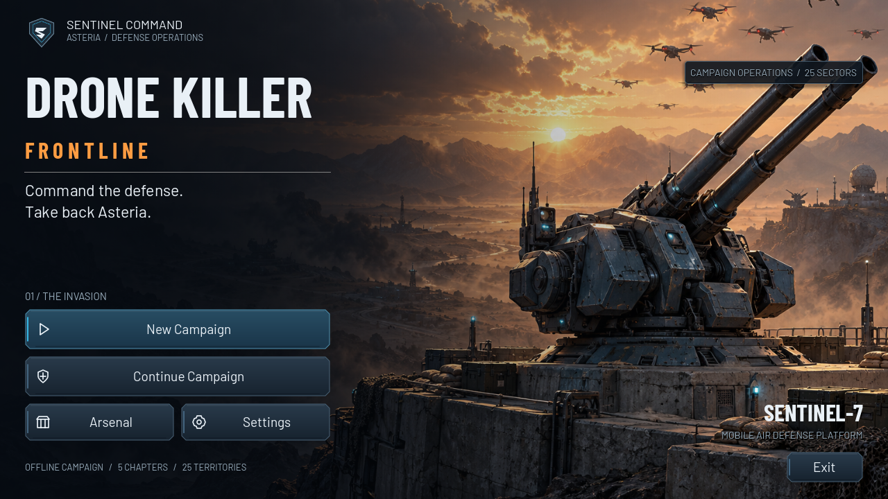
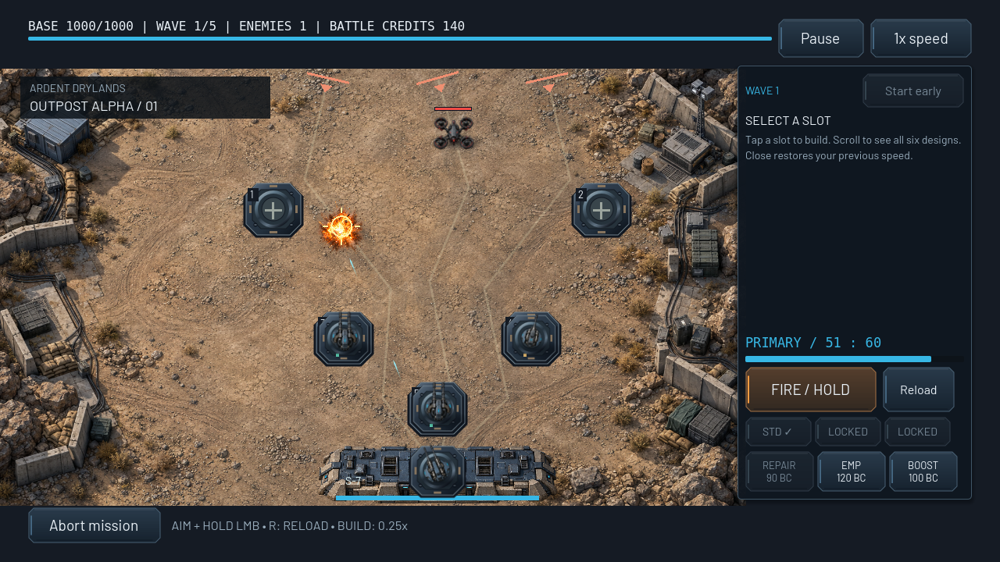

# G1 visual validation and native capture gallery

This is the historical G1 report. G2 supersedes the environment portion with [illustrated environments for all 25 territories](ENVIRONMENTS.md) and [new native captures](environments/README.md). G3 also supersedes the shared unit art with [distinct drones, bosses and weapons](UNIT_VISUALS.md). The G1 counts/images and remaining-work list below remain historical results of that earlier increment.

Godot 4.6.3 stable native import/startup and `./tests/run_checks.sh` completed with **4665 assertions and zero failures**. The runner isolated saves and rejected script errors, engine errors and ObjectDB leak warnings. The new visual suite contributes 245 resource, binding, transparency, theme, shader-state and effect-lifecycle checks.

| Suite | Assertions |
| --- | --- |
| COMBAT | 40 |
| HYBRID | 55 |
| SMOKE | 42 |
| SMOKE | 4 |
| SAVE/RULES | 38 |
| CAMPAIGN | 43 |
| CAMPAIGN | 5 |
| RESEARCH | 186 |
| RESEARCH | 4 |
| VISUAL FOUNDATION | 245 |
| CATALOG | 3689 |
| ENEMY AI | 88 |
| FULL CAMPAIGN | 184 |
| FULL CAMPAIGN | 31 |
| FULL CAMPAIGN | 11 |

The full campaign simulation again cleared all 25 missions using real shots, earned research and mission budgets. Defeat/reconquest, checkpoint floors, final liberation persistence, result-token protection, research, six defenses, ammunition, tactical slow time, pause, 2x speed and synthetic pointer/touch checks remained covered. These are regression/completion tests, not human balance or device-FPS proof.

## Native renderer verification

A real X11 display backed by a temporary Xvfb instance ran OpenGL 4.5 Compatibility on Mesa 25.0.7 llvmpipe (LLVM 19.1.7). `tests/visual_capture.tscn` captured the actual Godot viewport with local assets and native Controls. It reported zero failures and no script/engine errors. The software display emitted a nonfatal unsupported V-Sync-mode warning; no FPS claim is made.

The scene started an isolated test campaign, deployed Outpost Alpha, bought three defenses from the ordinary 500-credit budget, aimed/fired through the shared input adapter, advanced actual combat and waited for a real drone destruction. Captures were not composited, painted over, generated screenshots or HTML layouts. Native checks also confirmed uniform 1600×720 world scaling, normalized mouse aim after centering and a clickable pause control that clears held fire.

| Actual frame | Dimensions | What was checked |
| --- | --- | --- |
| [main_menu.png](visuals/main_menu.png) | 1280×720 | Native illustrated menu with active campaign navigation |
| [outpost_alpha.png](visuals/outpost_alpha.png) | 1280×720 | Live first-wave manual/automatic combat, ammo and temporary economy |
| [outpost_alpha_fx.png](visuals/outpost_alpha_fx.png) | 1280×720 | Animated explosion from an actually destroyed drone and visible projectiles |
| [outpost_alpha_build.png](visuals/outpost_alpha_build.png) | 1280×720 | Same live battle with tactical construction, slot selection and 0.25x mode |
| [outpost_alpha_wide.png](visuals/outpost_alpha_wide.png) | 1600×720 | 1600×720 native UI, uniform sprite proportions and charcoal framing |





## Art review and remaining production work

Integrated: original generated key art, terrain, bunker, a six-object drone/weapon sheet and six-frame explosion; authored shadows/muzzle/tracer/missile sprites; a shared actor presentation component; Compatibility-safe surface/terrain shaders; a reusable theme with metal button surfaces, native focus/press feedback, local typography and monochrome icon kit. The UI kit contains some unplaced icons, explicitly marked available rather than integrated in the manifest.

The 39 inventoried visual sources have dimensions/frame information, generation/source methods, licenses, integration status and hashes in [the manifest](../assets/manifest.json). Original generated PNGs remain art candidates; final continuity, perspective, material and commercial art approval are still required. Barlow fonts include SIL OFL notices, DejaVu includes its notices, and original vector/shader resources include the asset MIT notice. See [asset provenance](../assets/source/GENERATION.md) and [licenses](../assets/ASSET_LICENSE.md).

Dedicated external artwork still needed:

- The six support archetypes (Shield, EMP, Bomber, Sniper, Carrier, Stealth), currently using shared rendered base silhouettes plus retained semantic overlays.
- Five unique chapter-boss assets with phase/damage and ability animation variants; gameplay cores/telegraphs remain functional.
- Dedicated rendered Missile/Laser/EMP heads and standalone Heavy AA; the first three currently use explicitly interim authored SVGs, while Heavy AA shares the primary head.
- Rotor/damage animation sheets and final EMP/laser/overclock/impact effects with approved continuity.
- Terrain/prop kits for missions 2–25 were outstanding at G1; G2 now integrates 13 illustrated kits across all 25 missions, pending final art approval.
- Optional matching albedo/normal assets if a later device-reviewed dynamic lighting pass is commissioned. No artificial normal maps are presented as finished here.

Exact dimensions, pivots, frame/timing requirements and replacement workflow are in [VISUAL_STYLE.md](../VISUAL_STYLE.md). Replacement artwork can change visual bindings without rewriting gameplay.

## Limits and reproduction

This validates Linux software OpenGL rendering and automated gameplay/input paths. Physical Android appearance, multitouch hardware, audible output, cutout hardware, export/signing, FPS, memory, thermal behavior and battery use were not verified. The approximate 40 MiB large-texture mip budget is an estimate, not measured device usage. All 25 missions still require human difficulty/readability testing.

Run the suite with `./tests/run_checks.sh`. On a real desktop display, run the capture scene with isolated data:

```sh
XDG_DATA_HOME=/tmp/frontline-g1-data godot --path . --audio-driver Dummy res://tests/visual_capture.tscn -- --output=/tmp/frontline-g1-captures
```

The capture fixture deliberately starts a new test campaign. Use an isolated data directory as shown. It refuses the headless dummy display instead of claiming graphical validation. Runtime gameplay needs only Godot and bundled local resources; generation, Python, Xvfb and font downloads are not game dependencies.
