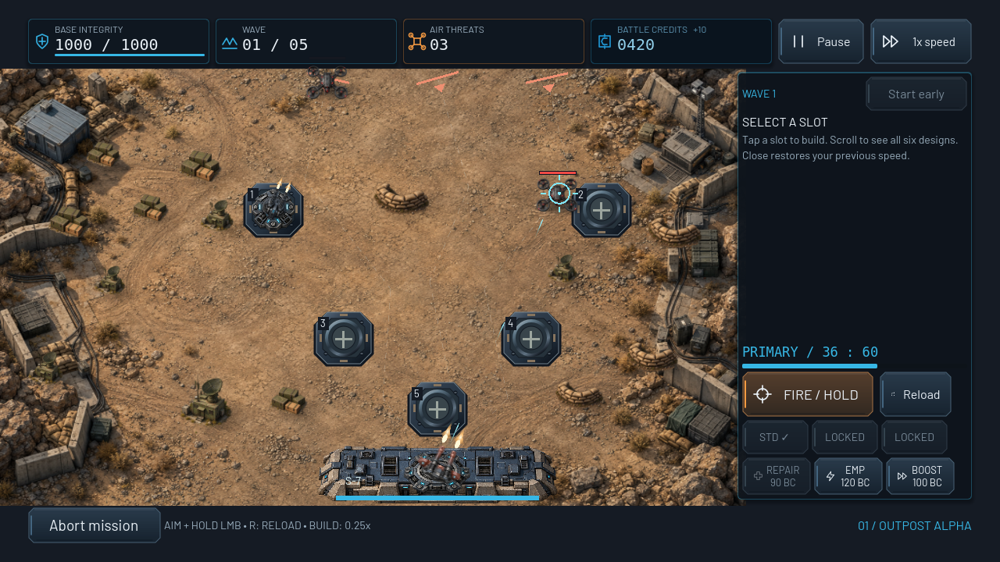

# G6 native audit evidence

2026-10-21 · unmodified Godot viewport PNGs · X11/Compatibility/llvmpipe · not Android screenshots.

[Audit, controls, measured limits and remaining artwork](../../GRAPHICS_AUDIT.md). [7332 automated assertions](checks.json). All runners reported zero failures. This directory is excluded from Godot imports by `.gdignore`.

## Terrain coverage

All 25 corrected early-wave native captures below use High, actual deployed enemies, real manual fire and a normal-budget automatic purchase. Deployment access is staged; they are not completed-mission or Android performance evidence. First five environments have different artwork. Remaining missions intentionally vary 13 shared kits. Low night samples verify readability without extra lighting.

- [01 — Outpost Alpha](mission_01.png)
- [02 — Red Hill Village](mission_02.png)
- [03 — East Supply Depot](mission_03.png)
- [04 — Broken Bridge](mission_04.png)
- [05 — Greyford](mission_05.png)
- [06 — North Power Station](mission_06.png)
- [07 — Riverside District](mission_07.png)
- [08 — Iron Highway](mission_08.png)
- [09 — Falcon Airbase](mission_09.png)
- [10 — Metro Asteria](mission_10.png)
- [11 — Western Ruins](mission_11.png)
- [12 — Liberation Road](mission_12.png)
- [13 — Black Ridge](mission_13.png)
- [14 — Border Fortress](mission_14.png)
- [15 — The Last Border](mission_15.png)
- [16 — Varkon Frontier](mission_16.png)
- [17 — Steel Valley](mission_17.png)
- [18 — Drone Assembly Plant](mission_18.png)
- [19 — Red Harbor](mission_19.png)
- [20 — Industrial Citadel](mission_20.png)
- [21 — Deadlands](mission_21.png)
- [22 — Varkon Defense Ring](mission_22.png)
- [23 — Central Command](mission_23.png)
- [24 — Capital Siege](mission_24.png)
- [25 — The Hive Core](mission_25.png)

- [Low — North Power Station](mission_06_low.png)
- [Low — Drone Assembly Plant](mission_18_low.png)
- [All environment counters](environment_metrics.json), [Low night counters](low_night_metrics.json)

## Interface, units and VFX selection

- [ui / main menu campaign](ui_main_menu_campaign.png)
- [ui / campaign final offensive](ui_campaign_final_offensive.png)
- [ui / arsenal research](ui_arsenal_research.png)
- [ui / settings](ui_settings.png)
- [ui / battle hud build](ui_battle_hud_build.png)
- [ui / battle build 1280x600](ui_battle_build_1280x600.png)
- [ui / victory results](ui_victory_results.png)
- [ui / defeat results](ui_defeat_results.png)
- [units / drone catalog](units_drone_catalog.png)
- [units / arsenal level3](units_arsenal_level3.png)
- [units / primary reload](units_primary_reload.png)
- [units / boss hive core phase3](units_boss_hive_core_phase3.png)
- [effects / weapon emp tower impact](effects_weapon_emp_tower_impact.png)
- [effects / weapon missile impact](effects_weapon_missile_impact.png)
- [effects / stress low](effects_stress_low.png)
- [effects / stress high](effects_stress_high.png)

Units/VFX stress and boss phase views deliberately stage enemies, funding/unlocks, damage thresholds or death events through real scene APIs. A visible fixture disclosure is drawn by Godot. UI results/progression may be staged to cover later chapters. No screenshots were composited or edited.

Full capture counters: [units (27)](unit_metrics.json), [UI (36)](ui_metrics.json), [VFX (36)](effect_metrics.json). Only selected images are checked in; the documented runners regenerate every frame.

## Reproducible stress diagnostics

- [Before G6 metrics](profile_before.json) / [final G6 metrics](profile_after.json)
- [Final Low](profile-final_stress_low.png) / [Medium](profile-final_stress_medium.png) / [High](profile-final_stress_high.png)

The 80-drone stress fixture is artificial; fixed simulation time is not wall-clock FPS. Raw reports retain all measured median/p95/max values, Godot version and renderer. See the audit for measurement methodology and noise limitations.
