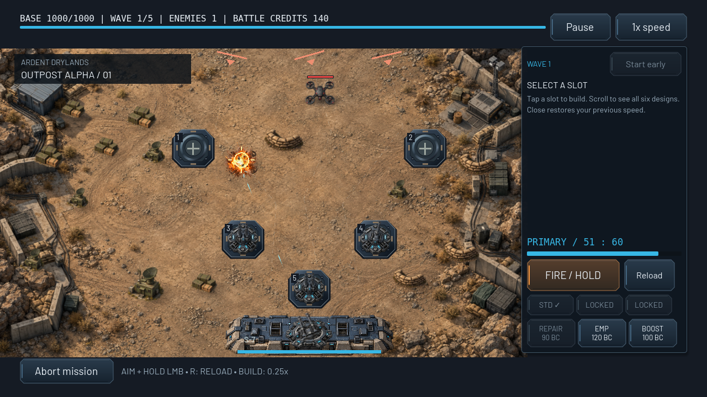
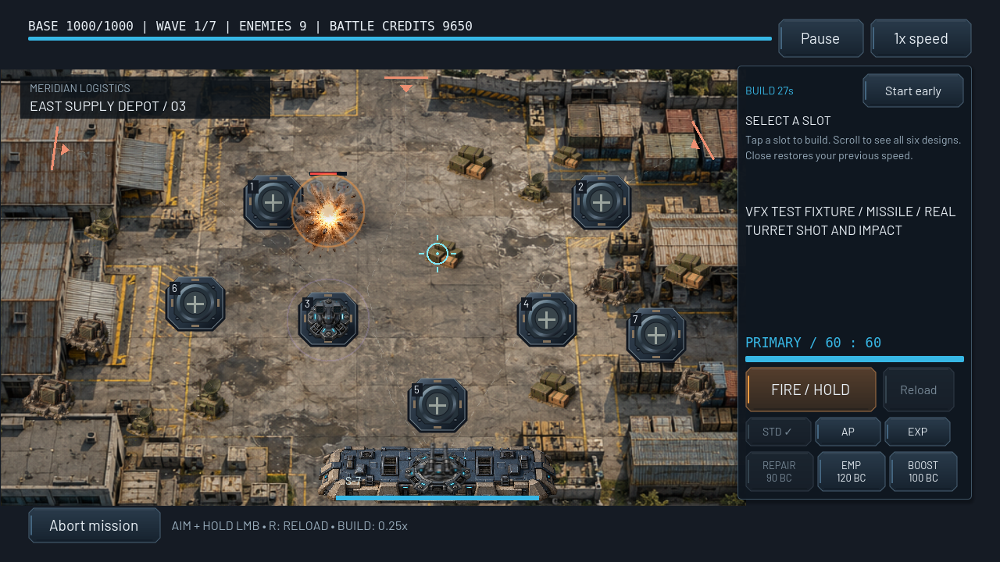

# G4 native combat VFX gallery

These are unmodified native Godot 4.6.3 Compatibility viewport captures, rendered on X11/OpenGL with Mesa llvmpipe. They are not mockups or Android hardware screenshots. [Architecture, limits and art status](../COMBAT_VFX.md) · [Validation](VALIDATION.md) · [Raw VFX draw-call/count samples](render_metrics.json).

The normal Outpost captures below use the actual starting budget, real mission waves, held manual fire and automatic turrets. Separate labeled VFX fixtures grant deployment/unlocks/funds, explicitly spawn enemies and sometimes apply direct damage to demonstrate every effect. Seeded critical coverage buys real critical-chance research, since the starting cannon has zero chance. Staged saved victories exercise result persistence and skipping; they are not claimed as earned full-mission wins. The independent full campaign tests cover actual mission completion.

36 VFX fixture frames, 27 unit-regression frames and five normal-wave frames were captured successfully. An additional mission-25 grid-interference capture verifies readable environmental pulses. This gallery commits 22 representative VFX frames, the grid capture and all five normal-wave frames; full fixture samples are reproducible using the scripts below. The previous G3 gallery remains historical rather than being overwritten.

## Real first-mission combat



[Active battle](live_outpost_alpha.png) · [Tactical building](live_outpost_alpha_build.png) · [1600×720 framing](live_outpost_alpha_wide.png) · [Main menu](live_main_menu.png)

## Weapons

| Actual firing / impact fixture | Native frame |
| --- | --- |
| Machine-gun muzzle / tracer | [Machine gun](weapon_machine_gun_fire.png) |
| Cannon recoil / heavy impact | [Cannon](weapon_cannon_impact.png) |
| Missile exhaust / area explosion | [Flight](weapon_missile_fire.png) · [Impact](weapon_missile_impact.png) |
| Laser beam / impact glow | [Laser](weapon_laser_impact.png) |
| EMP pulse / electrical status | [EMP](weapon_emp_tower_impact.png) |
| Heavy AA impact | [Heavy AA](weapon_heavy_aa_impact.png) |
| Primary Standard / AP / Explosive | [Standard](primary_standard_flight.png) · [AP](primary_armor_piercing_flight.png) · [Explosive](primary_explosive_impact.png) |
| Critical research / actual hit | [Critical](primary_critical.png) |
| Actual magazine reload | [Reload](primary_reload.png) |



## Destruction and screen feedback

[Heavy destruction](destroy_heavy_flash.png) · [Boss layered destruction/smoke](destroy_assault_carrier_smoke.png) · [Critical base HP](critical_base_damage.png) · [Boss arrival with readable health telemetry](boss_arrival.png) · [Mission 25 grid interference](grid_interference.png) · [Saved-result victory outro](victory_outro.png) · [Victory results](victory_results.png)

## Stress and accessibility

[80 death events at High](stress_high.png) · [Same fixture at Low](stress_low.png) · [Reduced effects and motion](reduced_effects_motion.png) · [Scrollable Settings](settings_quality.png)

The stress scenario emits 80 actual destruction/reward signals across eight simulated frames. High peaks at 192 pooled particles and Low at 48; surplus emissions are dropped and everything expires. It is a deliberate visual stress fixture, not a gameplay enemy-count change or an Android FPS benchmark. See the validation report for measured draw-call diagnostics and hardware limitations.

```sh
./tests/run_checks.sh
DISPLAY=:0 ./tests/run_effect_capture.sh /tmp/frontline-g4-captures
DISPLAY=:0 ./tests/run_effect_capture.sh /tmp/frontline-grid --interference-only
DISPLAY=:0 ./tests/run_native_capture.sh /tmp/frontline-unit-regression
XDG_DATA_HOME=/tmp/frontline-live-data DISPLAY=:0 godot --path . --audio-driver Dummy res://tests/visual_capture.tscn -- --output=/tmp/frontline-live-captures
```

Use isolated temporary XDG data/config/cache paths. All capture scenes require a real renderer and fail under a headless dummy display. `tests/run_effect_capture.sh` and `tests/run_native_capture.sh` provide isolation and reject engine errors even when the process returns zero. No physical Android performance, audio or touch test is implied.
