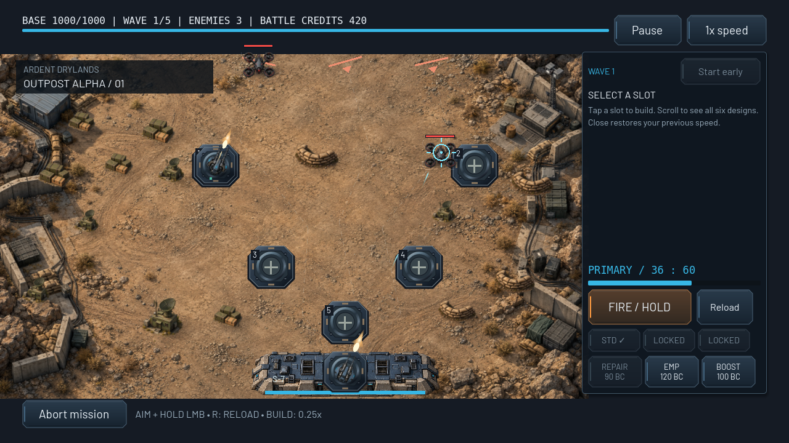
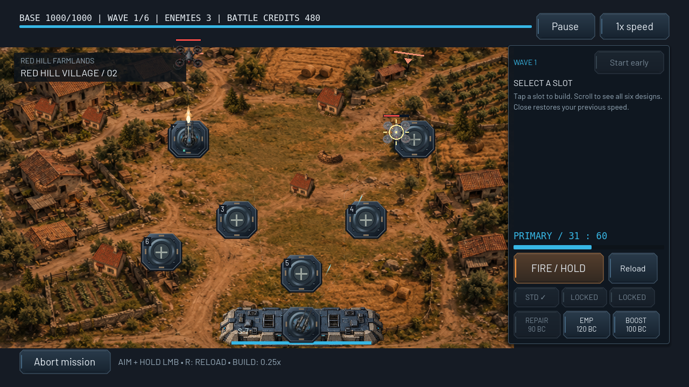
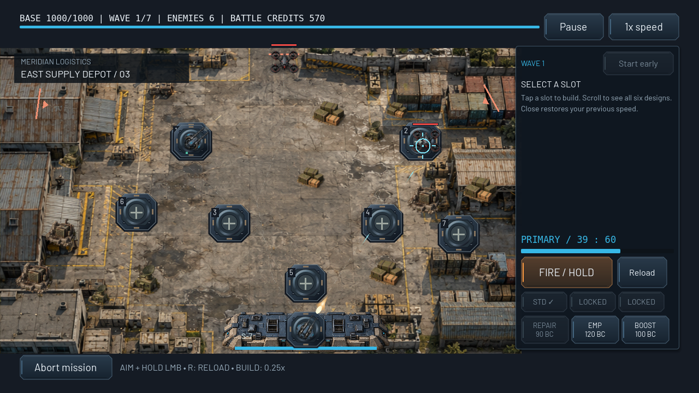
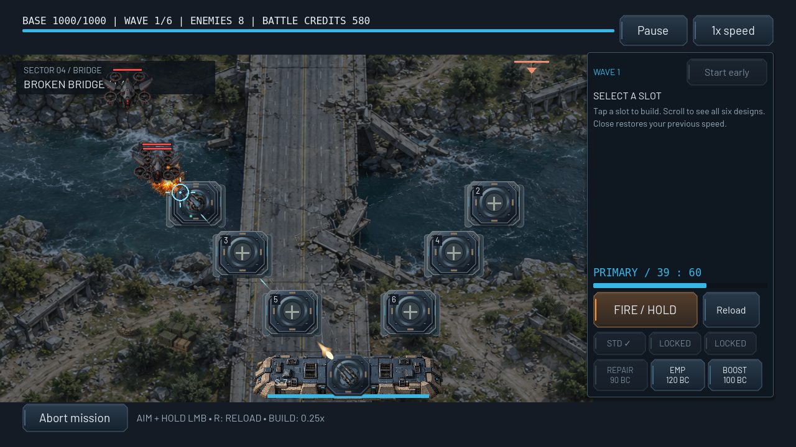
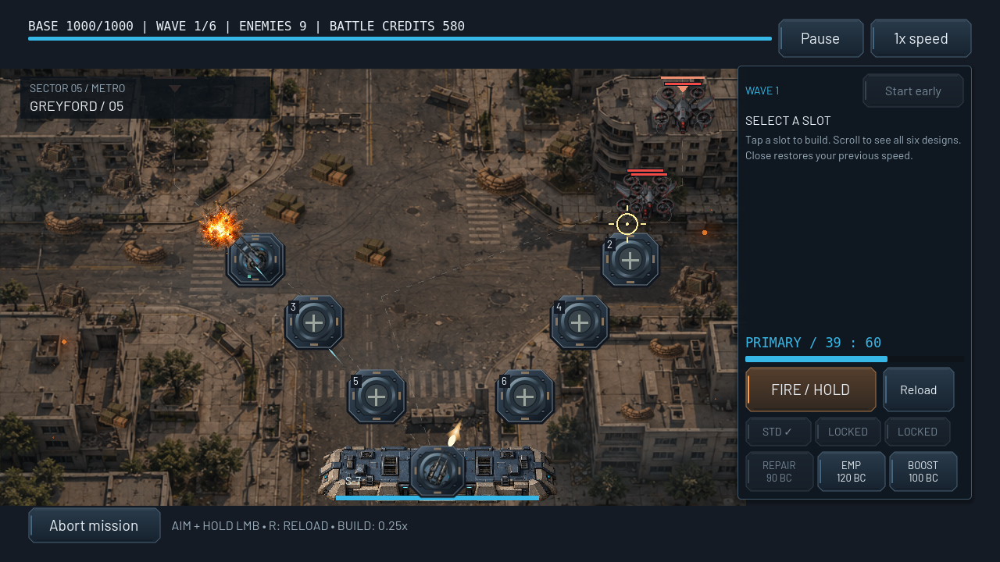

# G2 — native battlefield gallery

These PNGs are unmodified Godot viewport captures from real Compatibility/OpenGL gameplay, not generated screenshots. The capture fixture deployed all 25 missions, bought one Machine Gun with normal mission funds and fired 536 real manual rounds. All 25 scenes rendered without script/resource errors. It deliberately grants deployment access for visual inspection; full campaign completion is validated separately by the gameplay suite.

Renderer: Godot 4.6.3 stable, Linux X11, Mesa llvmpipe OpenGL 4.5 Compatibility. Reference size 1280×720; wide sample 1600×720. No Android hardware or FPS claim is implied. See [architecture, limitations and reproduction](../ENVIRONMENTS.md).

## 1. Outpost Alpha — day

## 2. Red Hill Village — sunset

## 3. East Supply Depot — day

## 4. Broken Bridge — storm

## 5. Greyford — smoke

## All territory captures

| Territory | Kit | Profile | Native PNG |
| --- | --- | --- | --- |
| 01 — Outpost Alpha | outpost | day | [View](mission_01.png) |
| 02 — Red Hill Village | village | sunset | [View](mission_02.png) |
| 03 — East Supply Depot | depot | day | [View](mission_03.png) |
| 04 — Broken Bridge | bridge | storm | [View](mission_04.png) |
| 05 — Greyford | urban | smoke | [View](mission_05.png) |
| 06 — North Power Station | power | night | [View](mission_06.png) |
| 07 — Riverside District | bridge | sunset | [View](mission_07.png) |
| 08 — Iron Highway | highway | day | [View](mission_08.png) |
| 09 — Falcon Airbase | airbase | night | [View](mission_09.png) |
| 10 — Metro Asteria | urban | night | [View](mission_10.png) |
| 11 — Western Ruins | ruins | smoke | [View](mission_11.png) |
| 12 — Liberation Road | highway | sunset | [View](mission_12.png) |
| 13 — Black Ridge | forest | storm | [View](mission_13.png) |
| 14 — Border Fortress | fortress | day | [View](mission_14.png) |
| 15 — The Last Border | fortress | sunset | [View](mission_15.png) |
| 16 — Varkon Frontier | forest | night | [View](mission_16.png) |
| 17 — Steel Valley | forest | day | [View](mission_17.png) |
| 18 — Drone Assembly Plant | industrial | night | [View](mission_18.png) |
| 19 — Red Harbor | harbor | storm | [View](mission_19.png) |
| 20 — Industrial Citadel | industrial | smoke | [View](mission_20.png) |
| 21 — Deadlands | ruins | storm | [View](mission_21.png) |
| 22 — Varkon Defense Ring | fortress | night | [View](mission_22.png) |
| 23 — Central Command | urban | sunset | [View](mission_23.png) |
| 24 — Capital Siege | ruins | sunset | [View](mission_24.png) |
| 25 — The Hive Core | fortress | smoke | [View](mission_25.png) |

Additional native checks: [reduced storm effects](mission_04_low_effects.png), [tactical upgrade controls](mission_05_build.png), [wide night airbase](mission_09_wide.png), [persistent effects setting](settings.png).

The first five captures demonstrate distinct military, village, storage, river and urban composition. Later captures show mountain forests, ruined cities, highway, airbase, harbor, power and enemy fortress kits. Shared kits vary their atmosphere and bounded prop placement; they are not 25 individually commissioned paintings. Generated illustration candidates still need final art approval and perspective/scale refinement.

[Final validation report](VALIDATION.md): 5719 automated assertions passed, plus native rendering of all 25 missions.
