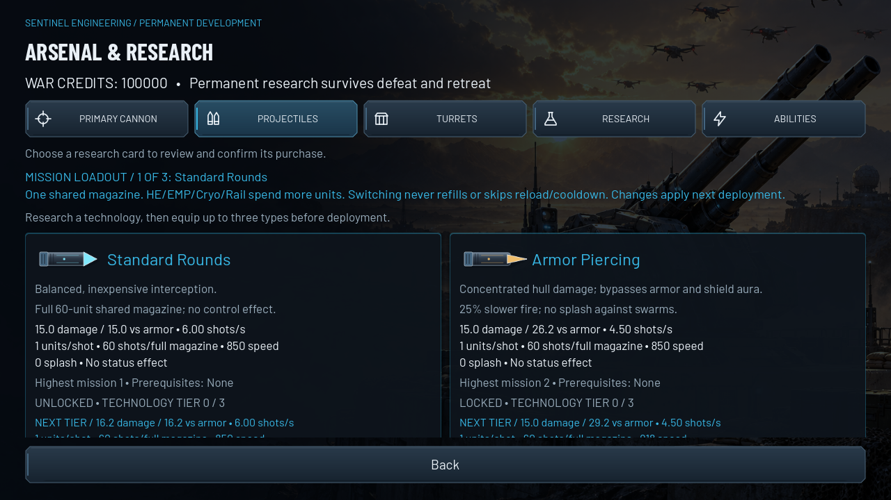

# M2 native research and weapon gallery

2026-10-21 · unmodified Godot X11/Compatibility/llvmpipe viewport captures. These are real interactive scene fixtures, not Android screenshots or edited mockups.

[Weapon system and rules](../WEAPON_RESEARCH.md) / [validation](VALIDATION.md) / [raw native counters](render_metrics.json).



- [Researched technologies](projectiles_researched.png)
- [Cryo/Rail cards, tier 3](projectiles_railgun.png)
- [Research at 1024×768](projectiles_1024x768.png)
- [Research at 1280×600](projectiles_1280x600.png)
- [Actual researched MG specialization](turret_specialization.png)
- [EMP electrical impact/status](emp_impact.png)
- [Cryo flight](cryo_flight.png) / [impact](cryo_impact.png)
- [Rail flight/penetration](railgun_flight.png) / [multiple impacts](railgun_impact.png) / [shared reload](railgun_reload.png)

The full runner emits 25 frames including all six technologies' flight/impact/reload; only a selection is checked in. Research uses a staged bank with actual paid transactions. Combat stages stationary targets and deployment access, and visibly labels this as a fixture. Native input actually changes the equipped three-slot loadout, operates HUD ammunition chips, owns aim/FIRE with independent touches, and reloads. Physical Android and human balance remain untested.

```sh
FRONTLINE_CAPTURE_SCENE=res://tests/weapon_capture.tscn ./tests/run_graphics_profile.sh /tmp/frontline-m2
```

A real display is required. Gallery files are excluded from Godot import by `.gdignore`.
