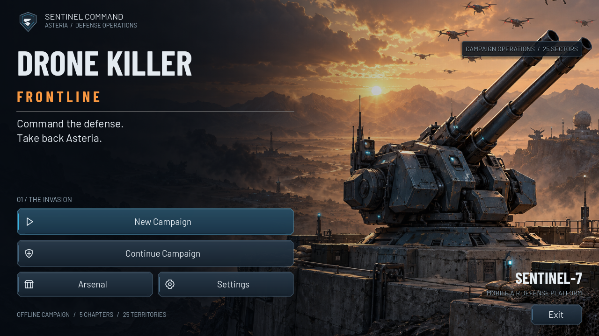
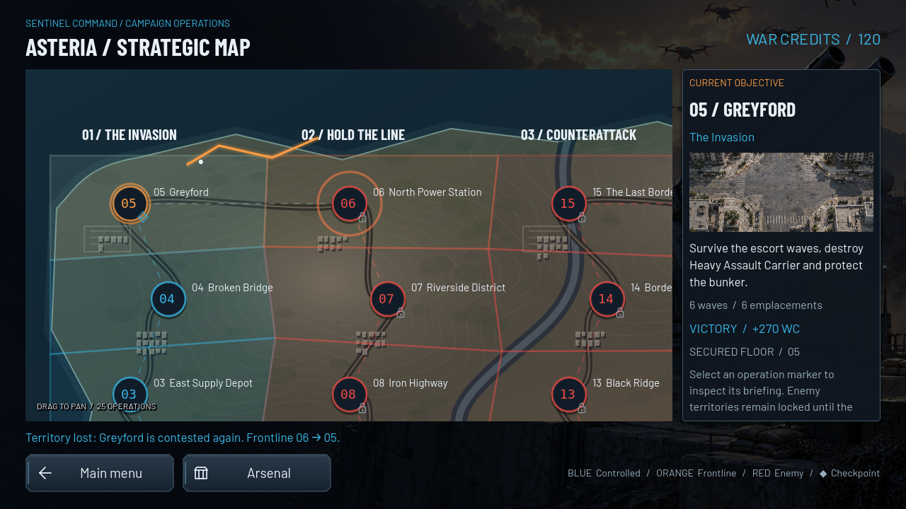
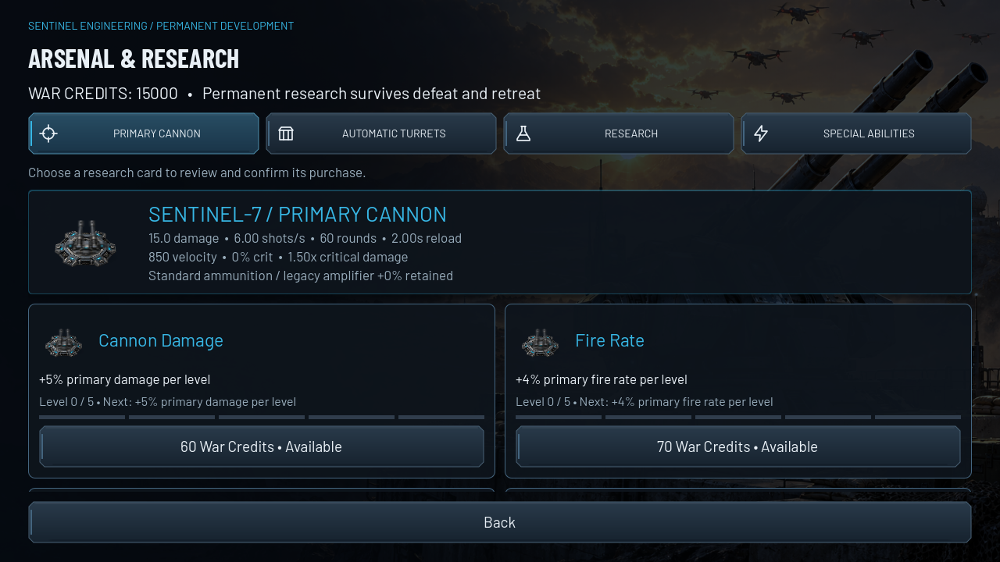
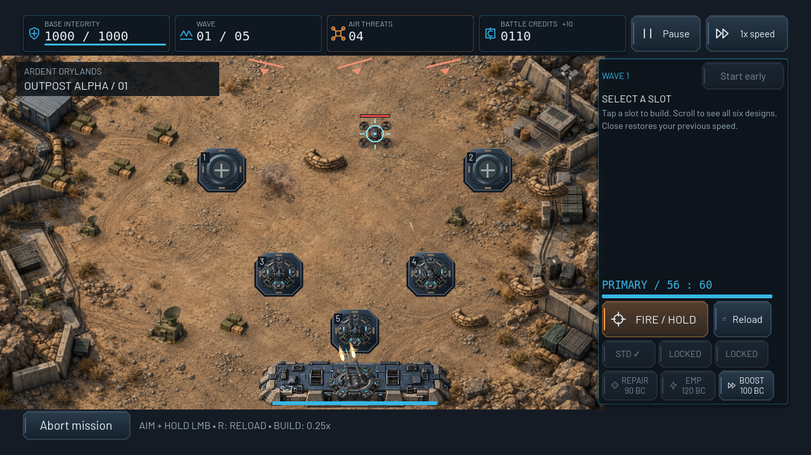

# G5 native UI gallery

All 36 PNGs are unmodified native Godot 4.6.3 Compatibility viewport captures. The renderer is X11/OpenGL with Mesa llvmpipe. These are actual interactive game screens; see [design/architecture](../UI_DESIGN.md), [validation](VALIDATION.md) and [raw samples](render_metrics.json).

**Visual-test fixtures:** the capture script starts with isolated saves, then stages higher chapter access and a research bank to cover the full interface. Conquest/retreat use real saved transactions with staged outcomes; the mission-six defeat respects floor five. Arsenal confirmation really purchases research, including its actual permanent effect in battle. The Outpost phase buys defenses through the real shop with the mission's starting Battle Credits, then simulates held manual fire, automatic attacks, real kills/reload and a paid Overclock activation. The staged victory/defeat screens test actual result ownership, not earned campaign-completion claims. Independent headless campaign combat covers all 25 missions and identical baseline results.

## Command and strategic map





[No-save menu / disabled Continue](main_menu_no_save.png) · [New campaign map](campaign_outpost.png) · [Briefing](mission_briefing.png) · [Conquest animation](campaign_conquest.png) · [Final Offensive access fixture](campaign_final_offensive.png) · [Map after defeat](campaign_after_defeat.png) · [Reduced-motion map](campaign_reduced_motion.png)

The full map pans; clipped operations stay reachable by dragging or keyboard focus. Current objective, chapter, reward and checkpoint come directly from the campaign state. Blue/orange/red ownership and saved transitions remain interactive throughout animation.

## Arsenal and settings



[Automatic turrets](arsenal_automatic.png) · [Research](arsenal_research.png) · [Special abilities](arsenal_abilities.png) · [Real confirmation](research_confirmation.png) · [Saved purchase feedback](research_purchased.png) · [Settings](settings.png)

## Battle and outcomes



[Construction](battle_hud_build.png) · [Turret upgrade](battle_hud_upgrade.png) · [Magazine reload](battle_hud_reload.png) · [Active paid Overclock](battle_hud_overclock.png) · [Pause](battle_hud_pause.png) · [Defeat/retry](defeat_results.png) · [Victory/rewards](victory_results.png)

## Responsive layouts

| Native logical viewport | Main menu | Campaign | Arsenal | Battle/build |
| --- | --- | --- | --- | --- |
| 1600×720 | [Menu](menu_1600x720.png) | [Map](campaign_1600x720.png) | [Research](arsenal_1600x720.png) | [HUD](battle_build_1600x720.png) |
| 1280×600 | [Menu](menu_1280x600.png) | [Map](campaign_1280x600.png) | [Research](arsenal_1280x600.png) | [HUD](battle_build_1280x600.png) |
| 1024×768 | [Menu](menu_1024x768.png) | [Map](campaign_1024x768.png) | [Research](arsenal_1024x768.png) | [HUD](battle_build_1024x768.png) |

Main actions remain within the tested viewport. Compact HUD mode keeps FIRE/reload/ammunition/abilities/build-close reachable; central aim input remains unblocked. The root safe-area handling is retained. These desktop logical-layout checks are separate from physical Android cutouts, touch hardware, FPS/thermal/memory and audible sound validation.

```sh
./tests/run_checks.sh
DISPLAY=:0 ./tests/run_ui_capture.sh /tmp/frontline-g5-captures
```

The capture wrapper isolates saves, requires a real renderer, checks exit status, rejects script/engine errors and documents the final draw-call samples. No HTML mockup, compositing or fabricated test image is used.
