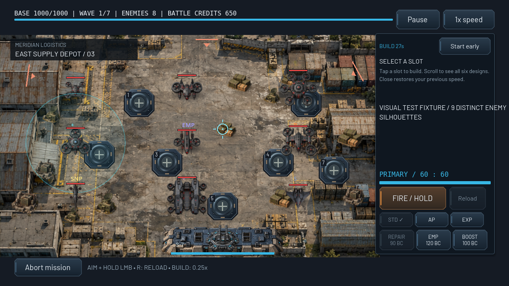
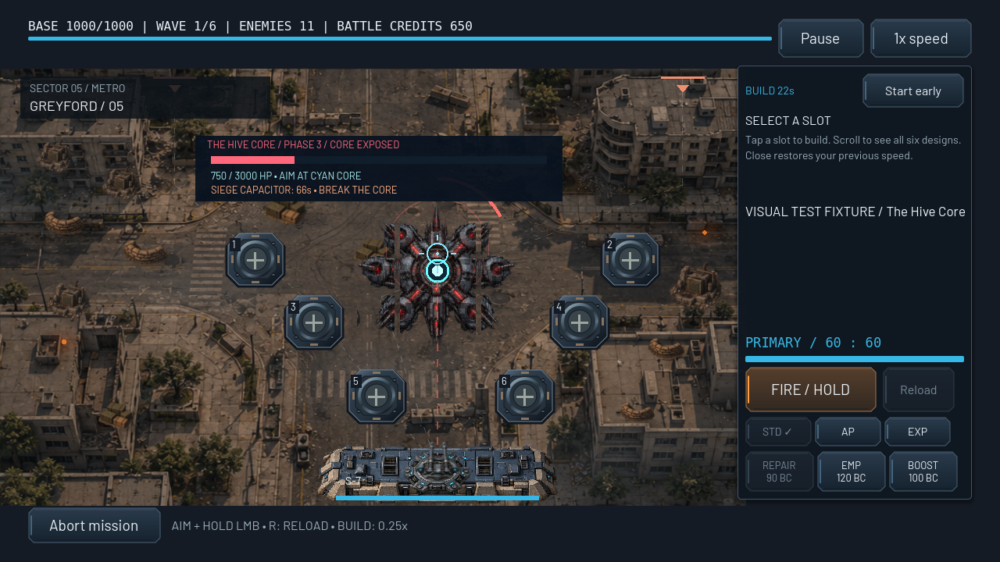
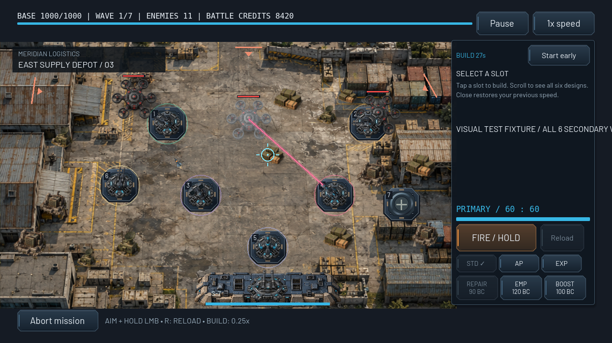
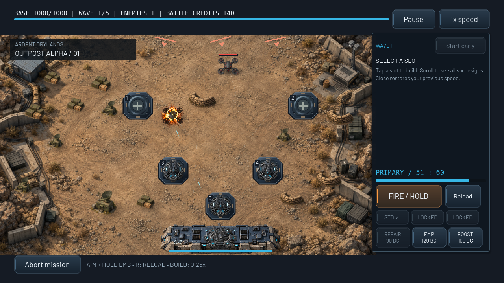

# G3 native unit gallery

G3 integrates distinct detailed art for all **nine drones, five bosses and seven weapons**. These are unmodified native Godot viewport PNGs, captured using Godot 4.6.3 Compatibility/OpenGL on Linux Mesa llvmpipe. They are not generated screenshots or composited mockups. Sources are original generated asset candidates; final art approval and physical Android profiling remain outstanding.

The labeled **visual fixtures** initialize positions, funds, unlocks, cloak time and phase damage inside the actual Gameplay/Main scenes so every archetype is exposed. They use real shop, hit, ammunition, reload, boss-AI and save/result APIs. They are not presented as ordinary campaign play. The Outpost Alpha captures below separately come from the existing normal-wave capture with actual starting funds, manual aiming and automatic attacks. Full campaign regression wins all 25 missions independently.

Final validation: **5983 assertions, zero failures**, plus two successful native capture processes. [Detailed results](VALIDATION.md) · [Machine-readable summary](validation.json) · [Raw per-capture render counters](render_metrics.json) · [Architecture/specifications](../UNIT_VISUALS.md).

## Nine drone silhouettes, damage and destruction

Grid order: Scout / Assault / Heavy; Shield / EMP / Bomber; Sniper / Carrier / Stealth. The Shield aura and other tactical overlays are retained game mechanics.

[Damage feedback](drone_damage.png) · [All nine detached destruction states](drone_destruction.png)

## Five chapter bosses

| Boss | Healthy | Phase 3 / armor open | Destruction |
| --- | --- | --- | --- |
| Heavy Assault Carrier | [View](boss_assault_carrier.png) | [View](boss_assault_carrier_phase3.png) | [View](boss_assault_carrier_destroyed.png) |
| EMP Warship | [View](boss_emp_warship.png) | [View](boss_emp_warship_phase3.png) | [View](boss_emp_warship_destroyed.png) |
| Armored Border Guardian | [View](boss_border_guardian.png) | [View](boss_border_guardian_phase3.png) | [View](boss_border_guardian_destroyed.png) |
| Drone Factory Command Ship | [View](boss_factory_ship.png) | [View](boss_factory_ship_phase3.png) | [View](boss_factory_ship_destroyed.png) |
| The Hive Core | [View](boss_hive_core.png) | [View](boss_hive_core_phase3.png) | [View](boss_hive_core_destroyed.png) |

## Six automatic weapons and primary

Slots 1–6: Machine Gun, Cannon, Missile, Laser, EMP, Heavy AA. The primary remains separate on the bunker. The fixture grants shop funds and weapon unlocks, then uses actual build/upgrade purchases.

[Actual level-three upgrades and reinforced primary](arsenal_level3.png) · [Primary heat from real firing](primary_standard_heat.png) · [Armor Piercing](primary_armor_piercing.png) · [Explosive](primary_explosive.png) · [Actual reload/autoloader](primary_reload.png) · [Pause](primary_pause.png)

## Boss victory presentation

[Skippable destruction](boss_victory_outro.png) · [Already-saved results](boss_victory_results.png). The fixture verifies the result is persisted before the outro, rejects a duplicate result/reward and uses an actual Escape input event to skip to results.

## Normal first-mission wave

The following capture deploys Outpost Alpha, buys defenses with the actual starting budget, aims/fires through the real input adapter and waits for actual manual/automatic shots and a real drone kill. No fixture grant or direct damage injection is used for these images.

[Live combat](outpost_alpha.png) · [Tactical build](outpost_alpha_build.png) · [1600×720 camera/input layout](outpost_alpha_wide.png) · [Retained main menu](main_menu.png)

Reproduce the unit fixture with `./tests/run_native_capture.sh /tmp/frontline-g3-captures` on a real display. Reproduce the normal-wave capture with `tests/visual_capture.tscn` and isolated saves as described in the style guide. Neither capture establishes physical Android FPS, thermal behavior, VRAM or multitouch.
